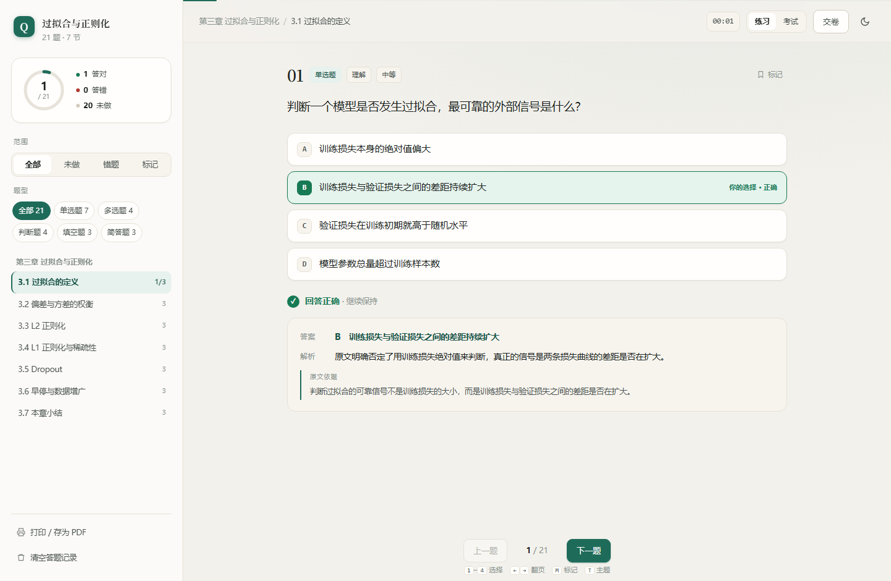

# pdfquiz

把 PDF / 讲义转成**可溯源**的复习题库：每一道题都必须能指回原文的某一句话，指不回去的直接丢弃。

```
PDF → 结构化 Markdown → 章节切块 → LLM 出题 → 溯源校验 → Markdown 题库 + 网页题库
```

这个仓库是为了回答一个问题而写的：GitHub 上「PDF 直接出题」的成熟开源项目几乎为零（搜 `quiz generator pdf` 按星排序，第一名只有 262 星）。缺的不是出题 prompt——那个五分钟能写完——缺的是**上游解析**和**下游校验**。



> 除了 Markdown，每次运行还会产出一个**单文件网页题库**（`*.quiz.html`）：无外链、无 CDN、双击即开，可作答、可判分、可翻页回顾。

## 为什么校验环节是重点

大模型出题有三类高频错误，靠 prompt 是压不住的：

| 错误类型 | 表现 | 本项目如何拦截 |
|---|---|---|
| 编造依据 | 题目看着合理，但原文压根没说 | `evidence` 必须逐字出现在原文，规范化后做包含判断 |
| 偷改语义 | 把「是」改成「不是」，把「通常」改成「一定」 | 同上，改动后字符不再匹配，直接判负 |
| 重复生成 | 同一知识点出五道几乎一样的题 | 题干 3-gram Jaccard ≥ 0.72 判重 |

实测：故意混入 1 道伪造引用的题（见 `tests/fake_mcp_server.py`），7 个章节全部被准确识别，淘汰率 50%。

## 四种模型接入方式

| Provider | 触发条件 | 说明 |
|---|---|---|
| `mcp` | 提供 `--mcp-cmd` | 通过 MCP 协议（stdio / JSON-RPC）调用任意 LLM 工具 |
| `openai` | 有 `OPENAI_API_KEY` | 任何 OpenAI 兼容接口（DeepSeek / 通义 / Ollama / vLLM） |
| `bridge` | 无 Key 且无 MCP | 导出提示词 → 外部智能体作答 → 回填，两段式 |
| `offline` | `--offline` | 不调用模型，从定义句生成问答，用于跑通链路自测 |

`--provider auto`（默认）：有 `--mcp-cmd` 走 MCP，有 Key 走 openai，都没有走 bridge。

## 快速开始

```bash
pip install pypdf                 # 最小依赖，纯文本兜底
python run.py samples/过拟合与正则化.md --offline -n 3
```

输出两份：`out/过拟合与正则化.quiz.md`（打印/归档）和 `out/过拟合与正则化.quiz.html`（直接在浏览器打开作答）。

## 网页题库

`render_html.py` 把校验通过的题注入一个自包含 HTML 模板（`pdfquiz/templates/quiz.html`），产物约 70 KB，**不依赖网络**——断网、内网、发给同学都能直接用。

| 能力 | 说明 |
|---|---|
| 五种题型 | 单选（点击即判）、多选（选完确认）、判断、填空（去空格标点后比对）、简答（对照参考答案自评） |
| 双模式 | 练习：作答即判；考试：全部作答后交卷统一判定并出报告 |
| 结果页 | 正确率环形图、答对/答错/待自评/未作答、分章节正确率条、错题清单可一键跳回 |
| 筛选 | 按范围（全部/未做/错题/标记）与题型过滤，长题库也能逐块过 |
| 记忆 | 答题记录、标记、模式写入 localStorage，刷新不丢 |
| 键盘 | `1`–`4` 选项、`←`/`→` 翻页、`Enter` 确认、`M` 标记、`T` 切主题 |
| 主题 | 浅色/深色两套，默认跟随系统 |
| 打印 | 打印样式会展开全部题目与答案，可直接存 PDF |


答题判定只做**客观题**：填空按去空格与标点后比对，简答题无法自动判分，因此走「查看参考答案 → 自己标记记住了/没答到」的路径，统计里单列为「待自评」，不混进正确率。

### 用 MCP 接入模型

```bash
python run.py 讲义.pdf \
  --mcp-cmd npx \
  --mcp-args "-y,@your-scope/llm-mcp-server" \
  --mcp-tool chat \
  --mcp-prompt-key prompt
```

客户端已实现 `initialize → notifications/initialized → tools/list → tools/call`。工具名写错时会直接列出服务器可用工具。

### 用 OpenAI 兼容接口

```bash
export OPENAI_API_KEY=sk-xxx
export OPENAI_BASE_URL=https://api.deepseek.com/v1   # 可选
export PDFQUIZ_MODEL=deepseek-chat                    # 可选
python run.py 讲义.pdf -n 4 --lang zh
```

### 桥接模式（无 Key，由当前会话的智能体出题）

```bash
python run.py 讲义.md --emit-prompts out/prompts.json -n 2
# 把 prompts.json 交给任意模型，按块作答，写成 out/answers.json
python run.py 讲义.md --answers out/answers.json -n 2
```

`answers.json` 格式见 `tools/build_bridge_answers.py`（本仓库的 14 道示例题就是这么做出来的）。

## 解析质量决定上限

`extract.py` 按质量降序自动探测，装了谁用谁：

| 解析器 | 安装 | 适用 |
|---|---|---|
| pymupdf4llm | `pip install pymupdf4llm` | 快，保留标题/表格，CPU 可跑 |
| docling | `pip install docling` | 结构化最好，MIT，支持 CJK，需下载模型 |
| pypdf | `pip install pypdf` | 零 ML 兜底，**丢标题层级/表格/公式** |

三者都没装会明确报错并给出安装命令，而不是静默降级。用 pypdf 时会打印警告——扫描件、双栏、公式文档在这条路径上质量不可用，请换 docling。

## 切块策略

按 Markdown 标题切，不按固定字数切。教材里一节 100–200 字是正常粒度，足够支撑 2–4 道题，所以默认只在正文短于 60 字（纯过渡句）时才把碎片并入**后**一节——这样章节标签不会失真，题库目录才能对上原书目录。

## 输出

| 文件 | 内容 |
|---|---|
| `out/<名>.quiz.md` | 题库：按章节分组 → 题目 → 答案与解析 → 被丢弃的题及原因 |
| `out/<名>.quiz.html` | 网页题库，单文件、离线可用（`--no-html` 可关闭） |
| `out/<名>.rejected.json` | 未通过校验的题与具体失败原因，用于调 prompt |
| `out/<名>.extracted.md` | 中间 Markdown（`--keep-md`） |

题库开头会给出题型 / 认知层次 / 难度的分布表。写作 prompt 里已设定目标分布（记忆 30% / 理解 40% / 应用 20% / 分析 10%），分布表用来检查模型是否真的照做了。

## 目录结构

```
pdfquiz/
├── run.py                      便捷入口
├── pdfquiz/
│   ├── extract.py              PDF→Markdown，三级解析器自动降级
│   ├── chunk.py                章节感知切块
│   ├── generate.py             prompt 构造 / 离线兜底
│   ├── llm.py                  OpenAI 兼容客户端（标准库实现）
│   ├── mcp_llm.py              MCP stdio 客户端
│   ├── verify.py               溯源校验 / 结构检查 / 去重  ← 核心
│   ├── render.py               Markdown 导出
│   ├── render_html.py          网页题库导出
│   ├── templates/quiz.html     单文件网页模板（内联样式与脚本）
│   └── cli.py                  命令行
├── tests/
│   ├── test_pipeline.py        15 项单测
│   └── fake_mcp_server.py      假 MCP 服务器，内含 1 道伪造题
├── samples/
└── tools/
```

## 测试

```bash
python -m unittest discover -s tests -v
```

覆盖：章节切分、超长切分、碎片合并、逐字命中、空白容错、伪造拒绝、否定翻转拒绝、过短拒绝、重复选项、答案越界、多选单答、判断题非法答案、跨题去重、离线题 100% 可溯源。

## 已知局限

1. **跨章节综合题会漏**。切块是局部的，模型看不到全局，所以「比较第三章与第五章的方法」这类题生成不出来。需要综合题时得另建一层全文章节索引。
2. **公式题能力取决于解析器**。pypdf 路径上公式基本不可用；docling/pymupdf4llm 能出 LaTeX，但选项里的公式渲染目前只做了纯文本透传。
3. **选择题干扰项质量靠模型**。校验只能保证「有依据」，不能保证「干扰项有迷惑性」。同一知识点重复生成时，模型倾向于复用同样的干扰项。
4. **未做跨块去重**。去重只在单块内生效，相邻章节的相似题目前不会互相查重。
5. **无图形界面**。纯 CLI，适合接进脚本或 CI。

## 示例产物

`examples/` 下的两份文件是用 `samples/过拟合与正则化.md` 跑出来的完整输出（21 题，覆盖五种题型）：

- `过拟合与正则化.quiz.html` —— 直接用浏览器打开就能作答
- `过拟合与正则化.quiz.md` —— 对照看题目、答案解析、分布表和丢弃记录长什么样

## 许可证

MIT，见 `LICENSE`。
