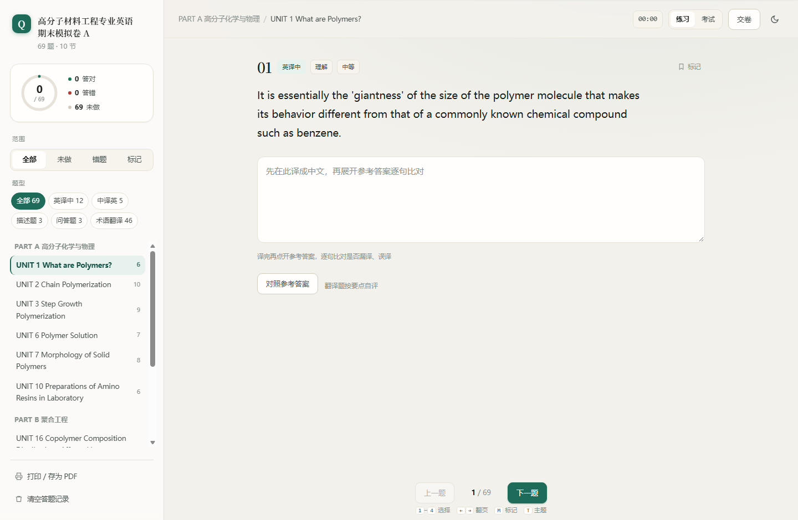
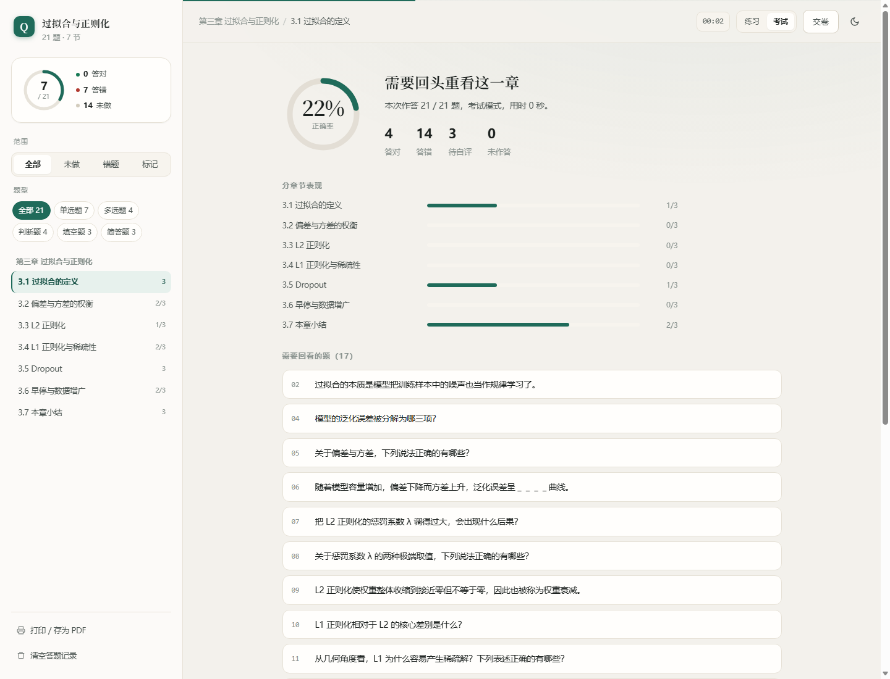
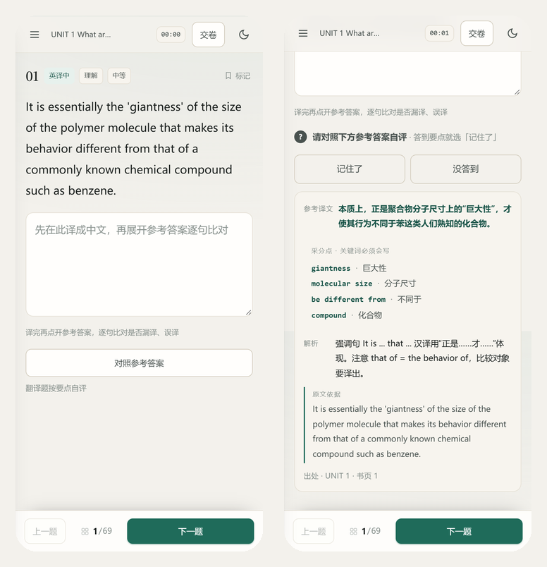

# pdfquiz

[](https://github.com/shushuzn/pdfquiz/actions/workflows/ci.yml)


把 PDF / 讲义转成**可溯源**的复习题库：每一道题都必须能指回原文的某一句话，指不回去的直接丢弃。

```
PDF → 结构化 Markdown → 章节切块 → LLM 出题 → 溯源校验 → Markdown 题库 + 网页题库
```

这个仓库是为了回答一个问题而写的：GitHub 上「PDF 直接出题」的成熟开源项目几乎为零（搜 `quiz generator pdf` 按星排序，第一名只有 262 星）。缺的不是出题 prompt——那个五分钟能写完——缺的是**上游解析**和**下游校验**。



**在线试作**：https://shushuzn.github.io/pdfquiz/ —— 一本 233 页扫描教材生成的 69 题试卷，正卷 100 分（英译中 60 / 中译英 10 / 描述 15 / 问答 15）＋ 术语速记附加 46 分。

> 除了 Markdown，每次运行还会产出一个**单文件网页题库**（`*.quiz.html`）：无外链、无 CDN、双击即开，可作答、可判分、可翻页回顾。旧的客观题样例在 https://shushuzn.github.io/pdfquiz/demo.html 。

## 为什么校验环节是重点

大模型出题有三类高频错误，靠 prompt 是压不住的：

| 错误类型 | 表现 | 本项目如何拦截 |
|---|---|---|
| 编造依据 | 题目看着合理，但原文压根没说 | `evidence` 必须逐字出现在原文，规范化后做包含判断 |
| 偷改语义 | 把「是」改成「不是」，把「通常」改成「一定」 | 同上，改动后字符不再匹配，直接判负 |
| 重复生成 | 同一知识点出五道几乎一样的题 | 题干 3-gram Jaccard ≥ 0.72 判重 |
| 跨页误判 | 书上的一句话被翻页切成两半，校验却把真话当幻觉丢掉 | 比对前先摘掉 `### p151` 页标记，断词 `rear-` / `ranged` 去连字符后拼回 |

实测：故意混入 1 道伪造引用的题（见 `tests/fake_mcp_server.py`），7 个章节全部被准确识别，淘汰率 50%。

## 四种模型接入方式

| Provider | 触发条件 | 说明 |
|---|---|---|
| `mcp` | 提供 `--mcp-cmd` | 通过 MCP 协议（stdio / JSON-RPC）调用任意 LLM 工具 |
| `openai` | 有 `OPENAI_API_KEY` | 任何 OpenAI 兼容接口（DeepSeek / 通义 / Ollama / vLLM） |
| `bridge` | 无 Key 且无 MCP | 导出提示词 → 外部智能体作答 → 回填，两段式 |
| `offline` | `--offline` | 不调用模型，从定义句生成问答，用于跑通链路自测 |

`--provider auto`（默认）：有 `--mcp-cmd` 走 MCP，有 Key 走 openai，都没有走 bridge。

## 快速开始

需要 Python 3.11+。

```bash
pip install -e .                  # 只装最小依赖（pypdf）
pdfquiz samples/过拟合与正则化.md --offline -n 3

# 想要更好的解析效果，按需加装
pip install -e ".[fast]"          # pymupdf4llm：快，保留标题/表格
pip install -e ".[docling]"       # docling：结构化最好，首次运行需下模型
```

装好后 `pdfquiz` 就是命令行入口，`pdfquiz --version` 可自查版本；不装也行，`python run.py <文件>` 等价。

开发：

```bash
pip install -e ".[dev]"
python -m unittest discover -s tests -v   # 64 项单测
python tests/smoke_cli.py                 # 端到端冒烟：离线跑一遍 CLI 并检查产物
ruff check .
```

CI 在 GitHub Actions 上跑 Python 3.11–3.14（外加 Windows），包含 lint、单测、冒烟三步。

输出两份：`out/过拟合与正则化.quiz.md`（打印/归档）和 `out/过拟合与正则化.quiz.html`（直接在浏览器打开作答）。

## 网页题库

`render_html.py` 把校验通过的题注入一个自包含 HTML 模板（`pdfquiz/templates/quiz.html`），产物约 70 KB，**不依赖网络**——断网、内网、发给同学都能直接用。

### 站点分两层：先选课程，再选卷子

题库不按「打开就是某张卷」来组织。课程写在仓库根目录的 `courses.json`，`tools/build_hub.py` 据此生成：

```
docs/index.html        课程选择页，只列课程，不点进去看不到卷子
docs/<课程>.html       该课程的卷子列表与刷题顺序
docs/<卷>.html         单份题库，侧栏「返回课程」回到课程页
```

新增一门课只要在 `courses.json` 里加一条（课程名、说明、产物目录、卷子 id），重新构建后首页就会多一个入口，不必改代码，也不会把不同课程的卷子混在同一个列表里。不同课程的卷子文件名可以用 `prefix` 区分，避免重名。

```bash
python tools/build_exam.py                      # 生成 out_exam/decks.json 与各卷
python tools/check_amc.py                       # 先进材料研究进展C：草稿自检
python tools/build_amc.py                       # 生成 out_amc/ 的四套题库与 decks.json
python tools/build_hub.py                       # 同步卷子到 docs/，生成课程页与首页
python tools/build_hub.py --course polymer-en   # 只重建一门课
```

课程页同时充当元数据缓存：某门课的 `out_*/decks.json` 缺失时（例如 `out_exam/` 依赖未公开的 `.units/`），`build_hub.py` 会从既有的 `docs/<课程>.html` 反推卷子 id、题数、分值与题型，再重建首页。这样重新生成站点不会因为缺一份生成物就整门课消失。

### 发布前检查

公开仓库只放转写稿（`corpus_amc/`）、题目草稿（`papers_amc/`）与构建后的 `docs/`。原始 PPT/PDF、教务系统截图、`.units/` 等含元数据或内部字段的文件不入库。

文本类隐私规则可以在提交前自查，CI 也会跑：

```bash
python tools/check_privacy.py
```

覆盖教师姓名/办公室、课程负责人、QQ、手机号、邮箱，以及 Bilibili / UTM 追踪参数；命中任意一条即返回非零退出码。图片与 PDF 里的水印、页脚不在规则范围内，只能靠提交前人工确认。

CI 还会在干净检出（没有 `out_*` 目录）上重跑 `tools/build_hub.py`，要求 `docs/` 无 diff，防止手改页面后忘记同步生成逻辑。

`corpus_amc/` 是从课件逐页转出的文字稿（`### S12` 是第 12 张幻灯片），`papers_amc/ch0N.json` 是按题型分组的草稿。`build_amc.py` 会把每条题的 `evidence` 送回对应章节逐字核对，对不上就整批退回、不生成产物——所以这两份文件是这个课程题库唯一的可信来源。

课程题库目前覆盖十章：第一章至第十章。第八章「传统碳材料」按 77 张幻灯片转录，分活性炭与炭黑两部分。


| 能力 | 说明 |
|---|---|
| 题型 | 客观题：单选（点击即判）、多选（选完确认）、判断、填空；主观题：英译中、中译英、描述、问答；术语翻译按输入精确比对自动判分 |
| 双模式 | 练习：作答即判；考试：全部作答后交卷统一判定并出报告 |
| 结果页 | 正确率环形图、**按分值折算的得分**、答对/答错/待自评/未作答、分章节正确率条、错题清单可一键跳回 |
| 采分点 | 主观题除参考答案外，额外列出必写关键词（中英对照），对应“关键词必须会写”的给分习惯 |
| 筛选 | 按范围（全部/未做/错题/标记）与题型过滤，长题库也能逐块过 |
| 术语容错 | 一个答案可给多个写法（`polyethylene / PE`），全称、缩写、连写回原文都判对 |
| 记忆 | 答题记录、标记、模式写入 localStorage，刷新不丢 |
| 键盘 | `1`–`4` 选项、`←`/`→` 翻页、`Enter` 确认、`M` 标记、`T` 切主题 |
| 主题 | 浅色/深色两套，默认跟随系统 |
| 打印 | 打印样式会展开全部题目与答案，可直接存 PDF |



答题判定只做**客观题**：填空与术语按去空格与标点后比对，简答/翻译/描述/问答无法自动判分，因此走「查看参考答案 → 自己标记记住了/没答到」的路径，统计里单列为「待自评」，不混进正确率。

### 手机上

题库的主要使用场景是通勤路上刷两题，所以移动端不是把桌面版缩一缩：

| 问题 | 处理 |
|---|---|
| 底栏在长页面里被顶到文档末尾，翻页要点半天 | 窄屏改成 `position:fixed` 吸底，正文预留 `padding-bottom`，并吃 `safe-area-inset` |
| iOS 聚焦输入框会放大整页 | 输入框字号提到 `max(16px, 正文字号)`，不再触发自动缩放 |
| 软键盘弹起后被固定底栏挡掉一行 | 聚焦输入时收起底栏（`body.kbd`），失焦恢复 |
| 翻译题固定 3 行，写两句就得抠着滚 | 文本框跟随内容自增高，上限 55vh 后转为内部滚动 |
| 长英文题干在手机上读着累 | 抽屉里有「正文字号 小/标准/大」三档，单独存 localStorage |
| 想跳回第 32 题要开抽屉再滚半天 | 底栏中间的数字点开是**题号面板**：按单元/按题型两种分组，颜色标出对/错/待自评/未做，点击直达 |
| 单手翻页够不到顶栏 | 题干区域支持横滑翻页（位移 > 55px 且明显偏水平才认，不抢竖向滚动） |
| 横滑被浏览器当成「后退」手势 | `overscroll-behavior-x: none` |
| 抽屉里章节列表自成滚动区，只露出三行 | 窄屏取消内层滚动，整个抽屉一起滚 |



同一份模板在平板与桌面仍是左右分栏，底栏回落到 `sticky`；题号面板在宽屏收成居中浮层而不是横贯整屏。

改了模板想给旧产物换新壳，不必重跑解析：

```bash
python tools/restyle.py examples/*.quiz.html      # 就地重渲染
python tools/restyle.py in.html -o out.html       # 另存
```


### 用 MCP 接入模型

```bash
python run.py 讲义.pdf \
  --mcp-cmd npx \
  --mcp-args "-y,@your-scope/llm-mcp-server" \
  --mcp-tool chat \
  --mcp-prompt-key prompt
```

客户端已实现 `initialize → notifications/initialized → tools/list → tools/call`。工具名写错时会直接列出服务器可用工具。

### 用 OpenAI 兼容接口

```bash
export OPENAI_API_KEY=sk-xxx
export OPENAI_BASE_URL=https://api.deepseek.com/v1   # 可选
export PDFQUIZ_MODEL=deepseek-chat                    # 可选
python run.py 讲义.pdf -n 4 --lang zh
```

### 桥接模式（无 Key，由当前会话的智能体出题）

```bash
python run.py 讲义.md --emit-prompts out/prompts.json -n 2
# 把 prompts.json 交给任意模型，按块作答，写成 out/answers.json
python run.py 讲义.md --answers out/answers.json -n 2
```

`answers.json` 格式见 `tools/build_bridge_answers.py`（本仓库的 14 道示例题就是这么做出来的）。

## 解析质量决定上限

`extract.py` 按质量降序自动探测，装了谁用谁：

| 解析器 | 安装 | 适用 |
|---|---|---|
| pymupdf4llm | `pip install pymupdf4llm` | 快，保留标题/表格，CPU 可跑 |
| docling | `pip install docling` | 结构化最好，MIT，支持 CJK，需下载模型 |
| pypdf | `pip install pypdf` | 零 ML 兜底，**丢标题层级/表格/公式** |

三者都没装会明确报错并给出安装命令，而不是静默降级。用 pypdf 时会打印警告——扫描件、双栏、公式文档在这条路径上质量不可用，请换 docling。

## 从一本扫描教材到一份模拟卷

教材是纯扫描件（233 页、无文字层）时，上文的 PDF 解析链路用不上：`pypdf` 抽不出字，OCR 引擎又装不上。这条路上实际跑通的流程是：

```
扫描页 → 逐页识读为结构化 Markdown（正文 / 词汇表 / 短语 / 注释分块）
       → 按试卷题型人工命制题目 + 从词汇表自动生成术语题
       → 同一套 evidence 校验 → Markdown 题库 + 网页试卷
```

题目文件放在 `papers/exam_a.json`，每题含题干、参考答案、**采分点**（中英对照的关键词）、教材原文依据与出处页。构建：

```bash
python tools/build_exam.py
```

它会做三件事：把试卷里的 `chunk_path` 按单元号重建成教材目录的写法（避免同一单元被拆成两段）、从 `## Words and Expressions` 自动生成术语题（只取正文中真实出现过的词，全局去重）、逐题走 `verify` 校验 evidence 是否真出自原文。

`UNIT` 与 `PART` 的归属取自教材目录页：PART A = UNIT 1–10，PART B = 11–20，PART C = 21–30。

## 切块策略

按 Markdown 标题切，不按固定字数切。教材里一节 100–200 字是正常粒度，足够支撑 2–4 道题，所以默认只在正文短于 60 字（纯过渡句）时才把碎片并入**后**一节——这样章节标签不会失真，题库目录才能对上原书目录。

## 输出

| 文件 | 内容 |
|---|---|
| `out/<名>.quiz.md` | 题库：按章节分组 → 题目 → 答案与解析 → 被丢弃的题及原因 |
| `out/<名>.quiz.html` | 网页题库，单文件、离线可用（`--no-html` 可关闭） |
| `out/<名>.rejected.json` | 未通过校验的题与具体失败原因，用于调 prompt |
| `out/<名>.extracted.md` | 中间 Markdown（`--keep-md`） |

题库开头会给出题型 / 认知层次 / 难度的分布表。写作 prompt 里已设定目标分布（记忆 30% / 理解 40% / 应用 20% / 分析 10%），分布表用来检查模型是否真的照做了。

## 目录结构

```
pdfquiz/
├── run.py                      便捷入口
├── courses.json                课程注册表：首页与课程页据此生成
├── pdfquiz/
│   ├── extract.py              PDF→Markdown，三级解析器自动降级
│   ├── ocr.py                  扫描页 OCR（RapidOCR，可选）
│   ├── ocr_md.py               OCR 结果重排为 Markdown（还原词汇表四列）
│   ├── chunk.py                章节感知切块
│   ├── generate.py             prompt 构造 / 离线兜底
│   ├── llm.py                  OpenAI 兼容客户端（标准库实现）
│   ├── mcp_llm.py              MCP stdio 客户端
│   ├── verify.py               溯源校验 / 结构检查 / 去重  ← 核心
│   ├── booktext.py             页标记 / 切句 / 词汇表 / 章节路径（纯函数，好测）
│   ├── render.py               Markdown 导出
│   ├── render_html.py          网页题库导出
│   ├── courses.py              课程注册表读取与页面命名
│   ├── templates/quiz.html     单文件网页模板（内联样式与脚本）
│   └── cli.py                  命令行
├── corpus_amc/                 课件逐页转录稿（ch01–ch10，先进材料研究进展C）
├── papers/                     各卷题目（题干/答案/采分点/出处）
│   ├── exam_key.json           考前重点卷（按老师划的范围与三件重点）
│   ├── exam_a.json / exam_b.json   平行模拟卷
│   ├── objective.json          客观题（填空 + 单选）
│   ├── materials.json          高分子材料名称中译英
│   ├── notes.json              教材 Notes 重点句
│   └── units/unitNN.json       分单元精练稿
├── papers_amc/                 先进材料研究进展C 的分章题库草稿（ch01–ch10）
├── tools/
│   ├── build_exam.py           试卷 + 词汇表 → 题库（校验、去重、导出）
│   ├── build_objective.py      原句挖空 + 词汇表四选一 → 客观题
│   ├── build_materials.py      正文里的材料名 → 中译英默写（配套 materials.tsv）
│   ├── build_hub.py            课程首页 + 课程页 + 卷子同步
│   ├── build_amc.py            分章草稿 → 客观题/精练/术语/模拟卷四套题库
│   ├── check_amc.py            草稿自检：证据逐字回查 + 题型结构 + 题量上下限
│   ├── extract_notes.py        抽 Notes 句子与教材原译
│   └── restyle.py              用最新模板重渲染已有题库，不重跑解析
├── pyproject.toml              打包 / 依赖 / ruff / console script
├── tests/
│   ├── test_pipeline.py        17 项单测（切块 / 溯源 / 结构 / 渲染）
│   ├── test_booktext.py        16 项单测（页标记 / 切句 / 跨页 evidence）
│   ├── test_courses.py         9 项课程注册表与页面生成测试
│   ├── test_amc.py             10 项分章题库测试（证据回查 / 章节分组 / 满分 100）
│   ├── smoke_cli.py            端到端冒烟：离线跑 CLI 并检查产物结构
│   ├── fake_mcp_server.py      假 MCP 服务器，内含 1 道伪造题
│   └── web/
│       ├── functional.mjs      前端功能测试（判分 / 自评 / 无异常）
│       ├── mobile.mjs          移动端交互测试（吸底 / 自增高 / 横滑 / 题号面板）
│       └── shots.mjs           批量截图
└── samples/
```

## 测试

```bash
python -m unittest discover -s tests -v
```

覆盖：章节切分、超长切分、碎片合并、逐字命中、空白容错、伪造拒绝、否定翻转拒绝、过短拒绝、重复选项、答案越界、多选单答、多选字符串答案、判断题非法答案、选项标号归一、跨题去重、离线题 100% 可溯源；课程侧覆盖注册表校验、首页不直链卷子、课程页去重课程名、卷子返回链接重定向；分章题库覆盖课件证据逐字回查、幻灯片→小节分组、模拟卷满分 100 且每章都抽到题。

前端测试直接驱动真实浏览器（本机 Edge / Chrome 以 `--remote-debugging-port=9222` 启动，用 Node 内置 WebSocket 走 CDP，无额外依赖）：

```bash
node tests/web/functional.mjs "file:///$PWD/docs/exam_a.html" 69   # 判分链路，按题库题型取舍
node tests/web/mobile.mjs     "file:///$PWD/docs/exam_a.html"      # 移动端交互 13 项
```

`functional.mjs` 按题库里实际存在的题型挑用例：教材卷覆盖术语精确比对与主观题自评，`docs/objective.html` 覆盖单选与填空判分，示例卷（`docs/demo.html`）覆盖多选与判断，缺哪类就跳过哪类，不会误报。

移动端那组用 CDP 的 `Input.dispatchTouchEvent` 真发触摸事件，断言底栏吸底、聚焦时收栏、文本框自增高、横滑翻页两个方向、题号面板分组与跳转、字号三档持久化、抽屉不再嵌套滚动。

## 已知局限

1. **跨章节综合题会漏**。切块是局部的，模型看不到全局，所以「比较第三章与第五章的方法」这类题生成不出来。需要综合题时得另建一层全文章节索引。
2. **公式题能力取决于解析器**。pypdf 路径上公式基本不可用；docling/pymupdf4llm 能出 LaTeX，但选项里的公式渲染目前只做了纯文本透传。
3. **选择题干扰项质量靠模型**。校验只能保证「有依据」，不能保证「干扰项有迷惑性」。同一知识点重复生成时，模型倾向于复用同样的干扰项。
4. **未做跨块去重**。去重只在单块内生效，相邻章节的相似题目前不会互相查重。
5. **无图形界面**。纯 CLI，适合接进脚本或 CI。

## 示例产物

`examples/` 下有两组完整输出：

1. **教材模拟卷**（69 题：英译中 12 · 中译英 5 · 描述 3 · 问答 3 · 术语 46），来自一本 233 页的扫描教材，正卷 100 分 + 术语附加 46 分：
   - `高分子材料工程专业英语.quiz.html` —— 在线版见 https://shushuzn.github.io/pdfquiz/
   - `高分子材料工程专业英语.quiz.md` —— 按单元分组，含采分点、原文依据与出处页
2. **过拟合讲义**（21 题，覆盖五种客观题型），用 `samples/过拟合与正则化.md` 跑出来，适合看纯自动链路的输出。

## 许可证

MIT，见 `LICENSE`。

教材原文仅以逐字引文（evidence）形式出现在题目解析里，不随仓库分发全本转录稿。
